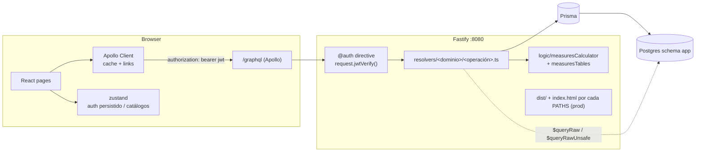
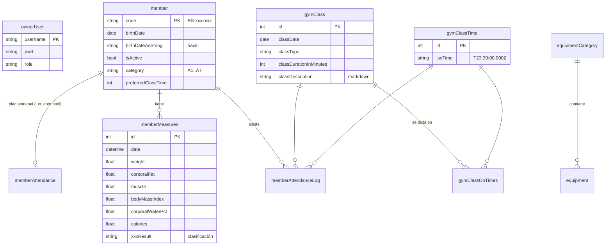

# Be Strong App — Arquitectura

> Estado actual del sistema (nov 2026), problemas encontrados y arquitectura objetivo para la reescritura del frontend.
> Ver también: [DISENO.md](./DISENO.md) (pantallas, look & feel, UX) y `docs/screenshots/`.

---

## 1. Qué es

App interna para administrar un gimnasio pequeño. La usa una sola persona (el dueño, rol `admin`) para:

- **Miembros**: alta, edición, activo/inactivo, plan semanal de asistencia y horario preferido.
- **Medidas corporales**: peso, grasa, músculo, IMC, % de agua y calorías tomados de una balanza de bioimpedancia. El servidor clasifica cada valor (por ejemplo "Peso normal" o "Regular") con tablas por edad y género.
- **Clases**: calendario diario, tipos de clase, horarios y asistentes por horario.
- **Equipo**: inventario por categorías.
- **Link público** (`/visit?code=…`) para que el miembro vea su progreso sin iniciar sesión.

## 2. Stack

| Capa | Tecnología |
|---|---|
| Servidor | Node, **Fastify 4**, **Apollo Server 4** (GraphQL), `@fastify/jwt` (HS512, 2 días) |
| Datos | **PostgreSQL** (schema `app`), **Prisma 5** (además, SQL crudo en 5 resolvers) |
| Cliente | **React 18**, **Vite 4**, **MUI 5**, **Apollo Client 3**, **zustand** (auth y catálogos), react-router 6, dayjs, chart.js, `@uiw/react-md-editor`, react-toastify |
| Compartido | `src/common` (enums, modelos y utils, importados por ambos lados) |
| Deploy | Docker Compose; el contenedor corre migraciones y seed en cada arranque |

## 3. Vista general



### Servidor

- `src/server/index.ts` registra Apollo, JWT, CORS (`origin: false`) y compresión. En producción sirve `dist/` y devuelve `index.html` en cada ruta de `PATHS`.
- El schema se arma con `makeExecutableSchema`: un archivo SDL por dominio en `typeDefs/` y un archivo por operación en `resolvers/<dominio>/`.
- La autorización es la directiva `@auth` del SDL. Una operación sin `@auth` es pública.
- El contexto es `{ prisma, server, request, saltRounds }`, con un único `PrismaClient`.
- Lógica de dominio: solo `logic/measuresCalculator.ts`, que clasifica las medidas. El resto de la lógica vive dentro de los resolvers.

### Cliente

- `app/` (providers, tema Iron claro/oscuro, layout con `TopBar` y navegación), `design-system/`, `features/<pantalla>/` y `gql/` (tipos generados con codegen). `AppRoutes.tsx` define las rutas con lazy loading; `ProtectedRoute` redirige a `/login` si no hay JWT.
- Estado global con zustand: `authState` (JWT persistido en `localStorage["auth"]`) y `catalogState`.

## 4. Modelo de datos



Nota: la tabla `user` existe pero no se usa.

## 5. El problema de las fechas (causa raíz)

Este bug provocó la mayor parte del código "parche" en el backend y en el frontend. **Se puede reproducir hoy**: un miembro registrado con nacimiento `1990-04-12` aparece como **11/04/1990** (captura `14-miembro-detalle-completo.png`).

### Qué pasa

1. Columnas como `member.birthDate` y `gymClass.classDate` son `@db.Date`, es decir, **un día de calendario sin hora ni zona**.
2. En GraphQL, el scalar `Date` se serializa como **epoch en milisegundos**, que representa un instante absoluto.
3. El cliente toma "12 abr" del date picker, que es la medianoche **local** en Costa Rica (UTC-6), y envía `getTime()`. Ese instante equivale a `1990-04-12T06:00Z`.
4. Postgres guarda `1990-04-12` y, al leerlo, Prisma lo devuelve como `1990-04-12T00:00Z`.
5. El navegador formatea en hora local: `1990-04-11 18:00`, así que se muestra **11/04**.

**Se usa un tipo de instante (timestamp) para representar un valor que no es un instante (una fecha de calendario).** A partir de ahí, cada capa compensa el error a su manera:

| Parche | Dónde |
|---|---|
| Columna duplicada `birthDateAsString` (`'1990-04-12T00:00:00.000Z'`) | schema, `AddMember`, `MemberPage`, `UpdateMember`, `getBirthdateMembers` (`to_char("birthDateAsString"::date …)`) |
| Backfill que **resta un día** a fechas existentes | `prisma/seed.js` → `updateBirthDate()` |
| Horarios guardados como texto UTC `"T23:30:00.000Z"` (= 5:30 PM CR) | `gymClassTime.isoTime`, `sortIsoTimes`, `formatIsoTime`, `parseIsoTimeToDate` |
| `isoFormatDate(date, withTime)` agrega `T00:00:00.000Z` a mano | `client/utils/helpers.ts` |
| `getIsoTime(yyyy-mm-dd)` → `new Date(str).toISOString()` | `server/utils/dateshelper.ts` |
| `getDateAndTimeWithLimit` usa `setHours` en la zona horaria **del servidor** | filtros de medidas |

En total hay **~109 usos de `new Date` / `dayjs` / `toISOString` / ISO strings** dispersos.

### Cómo debió hacerse (y cómo lo haremos)

Hay tres tipos de "tiempo", cada uno con su propia representación de punta a punta:

| Concepto | Ejemplos | DB | GraphQL | Cliente |
|---|---|---|---|---|
| **Fecha de calendario** | nacimiento, fecha de clase | `date` | scalar `LocalDate` = `"YYYY-MM-DD"` (string) | string; dayjs solo para formatear (`dayjs(s).format('DD/MM/YYYY')`, **nunca** `new Date(s)`) |
| **Hora del día del gimnasio** | horario 5:30 PM | `time` o `"HH:mm"` | `LocalTime` = `"17:30"` | string |
| **Instante** | fecha de medición, createdAt, login | `timestamptz` | `DateTime` = ISO-8601 con `Z` | `Date` / dayjs, se muestra en la zona del gimnasio |

- La zona del gimnasio (`America/Costa_Rica`) se declara **una sola vez** como configuración y se usa solo para *mostrar instantes* o *calcular "hoy"*.
- Migración: convertir `birthDateAsString` → `birthDate` (`date`), eliminar la columna y el backfill del seed, y convertir `isoTime` UTC → `time` local. Hay que verificarlo contra la BD de producción **antes** de borrar nada.

## 6. Problemas encontrados

Ordenados por impacto.

### Seguridad

| # | Problema | Evidencia |
|---|---|---|
| S1 | **`ownerSignUp` es público**: cualquiera puede crear un usuario admin con un POST. | `loginSchema.ts` (mutation sin `@auth`). Se verificó en local creando el usuario `demo`. |
| S2 | **`/visit` y `getVisitMember` son públicos**: la protección es solo `base64(code)`. Con el código del miembro se ven todas sus medidas y asistencias. | `memberSchema.ts`, `VisitLink.tsx`, capturas `55`/`56`. Conviene usar un token aleatorio revocable por miembro, o expiración. |
| S3 | `getMemberAttendanceLogByYear` y `getMemberAttendanceLogsDetails` no tienen `@auth` (los usa `/visit`). | `memberAttendanceSchema.ts` |
| S4 | Si falta `SECRET_KEY`, el JWT se firma con `'supersecret'`. Debería fallar al arrancar. | `plugins/auth.ts` |
| S5 | JWT guardado en `localStorage` y sin refresh: expira a los 2 días con logout duro. | `authState.ts` |
| S6 | `getFilteredMembers(column, comparator, filter)` arma un `where` de Prisma con columna y operador arbitrarios que vienen del cliente. | `getFilteredMembers.ts` |
| S7 | La contraseña del seed (`BeStrongApp`) no cumple las reglas que la UI exige al cambiarla. | `UpdatePwd.tsx` vs. seed |

### Bugs funcionales

| # | Bug | Causa |
|---|---|---|
| B1 | Fechas de nacimiento con un día menos. | §5 |
| B2 | **Inputs numéricos**: al vaciar el campo aparece un `0` que no se puede borrar (`82` → borrar → `0` → escribir `75` → `075`). | `Number(value)` dentro del estado de un input controlado (`Number('') === 0`): `EditMeasure.tsx:61`, `AddMeasure.tsx:101`, `AddMember.tsx:102`, `addClassModal.tsx:120`. **Arreglo:** guardar el string en el estado y convertir al enviar (o usar un form lib). Capturas `21b`, `19b`. |
| B3 | La diferencia de la primera fila del rango filtrado sale "-" aunque haya medidas previas. | `getMeasures.ts`: `lag()` se evalúa después del `WHERE date BETWEEN`. Hay que calcular el `lag` en un CTE sin filtrar y filtrar afuera. |
| B4 | Avatares rotos: dependen de `robohash.org` (hoy responde 525) y aparece el *alt text* desbordado. | `createAvatarLink`. Usar iniciales locales como fallback. Capturas `11`, `30`. |
| B5 | `refetchQueries: ['homeQueries']` apunta a una query que no existe (warning en consola). | `AddMember.tsx` |
| B6 | Al hacer clic en el texto "Mostrar acciones" no se activa el switch (la etiqueta no está asociada). | `MemberMeasuresData` |
| B7 | "Editar nombre" de una categoría vuelve editable el `<h>` (`contentEditable`) sin ninguna señal visual, y React lanza un warning. | `EquipmentCategoryCard.tsx:106` |
| B8 | Los diálogos no cierran con Escape (`disableEscapeKeyDown` y se ignora el clic en el backdrop). | `AddMember.tsx` y otros |
| B9 | Textos copiados: el diálogo "Nuevo horario" de Configuración dice "Agrega un nuevo horario **a la clase**". | `config/TimePickerDialog.tsx` |
| B10 | El selector de año de asistencias lista desde **1900**. | `BsYearPopover.tsx` |

### Deuda técnica en el frontend (el "spaghetti")

Métricas de `src/client` (~10k líneas):

| Señal | Cantidad | Qué indica |
|---|---|---|
| `eslint-disable` | 63 | Tipos `any`/unsafe silenciados en lugar de tipar las respuestas GraphQL. |
| `sx={…}` inline | 144 | Estilos dispersos; no hay sistema de diseño. |
| `styled(…)` | 62 | Otra capa de estilos distinta, además de `sx`. |
| Colores hex hardcodeados | 104 | El theme solo define `primary`. |
| `useEffect` | 28 | Muchos sincronizan estado derivado. |
| `cache.modify` / `refetchQueries` | 10 | Cache de Apollo mantenido a mano. |

Patrones concretos:

1. **Copiar el estado del servidor a `useState`.** `MemberPage` usa `useQuery(..., { fetchPolicy: 'no-cache', onCompleted: setMember })` y luego mantiene `member` a mano. Así se pierde el cache, se duplican las fuentes de verdad y se reescribe el estado en `onError`.
2. **"Eventos" con booleanos y `setTimeout`.** `MemberContext.triggerReloadMeasures()` pone `true` y luego `false` después de 100 ms para que otro componente reaccione en un `useEffect`. Hay que reemplazarlo por invalidación de queries (`refetchQueries` o las *keys* de TanStack Query) o por props/callbacks.
3. **Props con nombres de flags** como `newMeasureWasAdded` + `updateMeasureWasAddedFlag`. Es el mismo problema que el punto anterior.
4. **Formularios a mano.** Cada diálogo reimplementa estado, validación (`readyToBeSaved` en un `useEffect`), conversión numérica (B2) y reseteo. Hay 6 diálogos casi idénticos.
5. **Componentes que hacen todo**: fetch, mutación, mapeo de tipos, layout y estilos en el mismo archivo (`AddMember` 273 líneas, `MemberInfo` 271, `Filters` 280, `MemberMeasuresData` 279).
6. **Dos implementaciones de tabla** (`BsTable` y `SimpleTable`) y dos de gráfico (`BsChart`, `visit/Chart`, `member/MemberMeasures/Chart`).
7. La lógica de **fechas y horarios** está repartida en `helpers.ts`, `memberUtils.ts`, `dateshelper.ts` y los componentes (§5).
8. `middlewares/authUser.ts` y la tabla `user` están **muertos**. `src/client/utils/python` y `delete_later/` deberían revisarse.
9. Los callbacks `onCompleted`/`onError` de `useQuery` y `useLazyQuery` están **deprecados** en Apollo 3.8+ y se eliminan en Apollo 4 (generan decenas de warnings en consola).

### Backend

- Los resolvers mezclan acceso a datos y reglas, sin capa de servicios (aceptable al tamaño actual).
- Hay SQL crudo en 5 resolvers. Está parametrizado, así que no hay inyección, pero duplica la lógica de `lag()` en `getMeasures` y `getLastMeasure`.
- No hay tests, ni siquiera de `measuresCalculator`, que es la lógica más valiosa y la más fácil de testear.
- Las migraciones y el seed corren en cada arranque del contenedor.

## 7. Arquitectura objetivo (implementada)

> Estado: implementado en el rediseño. Cerrados B1–B10 y S1, S4 y S6.

La regla es mantener el backend GraphQL y reescribir el cliente por *features*, con estado del servidor manejado por la librería y no a mano.

```
src/client/
  app/            # providers (Apollo, Theme, Router), layout, rutas
  design-system/  # tokens, theme MUI (o Tailwind), componentes base: Button, Card, Dialog, FormField, DataTable, Chart, Avatar, EmptyState
  features/
    members/      # MembersList, MemberForm, api.ts (queries+mutations tipadas), hooks
    measures/     # MeasureCards, MeasureForm, MeasureHistory (tabla+gráfico), api.ts
    classes/      # DayCalendar, ClassCard, AttendanceEditor, ClassForm, api.ts
    equipment/
    auth/         # Login, ProfilePage, ChangePassword
    visit/        # página pública
  lib/
    dates.ts      # ÚNICO lugar con lógica de fechas (LocalDate, LocalTime, Instant)
    gql/          # tipos generados (graphql-codegen)
```

Decisiones clave:

1. **graphql-codegen** (`typed-document-node`) para tipar queries y mutaciones. Elimina los 63 `eslint-disable` y los `as unknown as`.
2. **El cache de Apollo es la única fuente de verdad del servidor**: nada de `no-cache` + `useState`. Después de una mutación se usa `refetchQueries` sobre la query concreta o `cache.modify` desde un helper por entidad.
3. **react-hook-form + zod** para todos los formularios. Resuelve B2 (inputs numéricos como string y `z.coerce.number()` al validar) y unifica la validación y los mensajes de error.
4. **Un único `DataTable` y un único `MeasureChart`.**
5. **`lib/dates.ts`** con los tres tipos de §5, más la migración de DB correspondiente.
6. **Design system propio** (ver DISENO.md §5): tokens en el theme y cero hex sueltos.
7. **Tests**: Vitest para `measuresCalculator` y `lib/dates`, y un smoke test con Playwright de los flujos capturados.
8. **Seguridad**: proteger `ownerSignUp` (o eliminarlo), usar tokens de visita aleatorios y revocables, y fallar al arrancar si falta `SECRET_KEY`.

### Orden sugerido

1. Arreglos de seguridad S1–S4 (son pequeños e independientes).
2. Agregar `lib/dates.ts`, los scalars nuevos y la migración de fechas (con respaldo y verificación en producción).
3. Agregar codegen y design system (tokens y componentes base).
4. Reescribir por feature, de la más simple a la más compleja: Equipo → Configuración/Perfil → Miembros → Clases → Detalle de miembro/Medidas → Visit.
5. Borrar el código muerto que quede.
