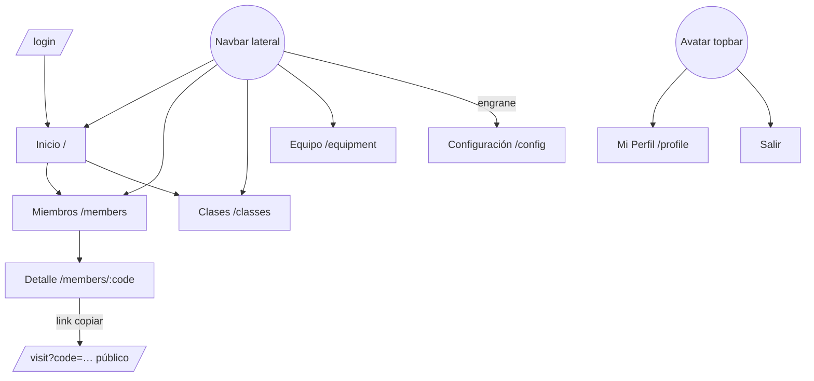

# Be Strong App — Diseño (estado actual y base para el nuevo look & feel)

> Inventario de pantallas y funcionalidades capturado con Playwright el 2026-11-03 (escritorio 1440px y móvil 390px).
> Las capturas están en [`docs/screenshots/`](./screenshots). Arquitectura y bugs: [ARQUITECTURA.md](./ARQUITECTURA.md).

---

## 1. Mapa de la app

Navegación: **rail lateral** de 70px con icono y texto (Inicio, Miembros, Clases, Equipo, más un engrane abajo) y **top bar** con el nombre de la app y el avatar del usuario. En móvil, el rail se convierte en un drawer que se abre con el botón ☰.

## 2. Inventario de pantallas y funcionalidades

### 2.1 Login: `/login`
| Captura | Qué muestra |
|---|---|
| `01-login-vacio` | Ilustración a la izquierda y tarjeta con el logo, "Bienvenido", usuario y contraseña. |
| `02-login-credenciales-invalidas` | El error "Usuario o contraseña incorrectos" se repite debajo de **ambos** campos. |
| `60-movil-login` | Versión móvil. |

Funcionalidad: el botón "Ingresar" permanece deshabilitado hasta llenar ambos campos, sin decir por qué. Tiene toggle para ver la contraseña. Usa el JWT persistido.

### 2.2 Inicio: `/`
| Captura | Qué muestra |
|---|---|
| `03-home-dashboard-sin-datos` | Saludo según la hora ("Buenas tardes"), dos KPI (Miembros activos y Clases del año) con "Ver Más", y "Eventos para hoy" (clases y cumpleaños) en estado vacío. |
| `10-home-dashboard-con-datos` | La clase de hoy aparece como píldora con degradado y los cumpleaños como chip 🎂. |
| `61-movil-home` | Las KPI se apilan a lo ancho completo. |

### 2.3 Miembros: `/members`
| Captura | Qué muestra |
|---|---|
| `05-miembros-lista-tarjetas` / `11-miembros-lista-con-datos` | Grid de tarjetas con avatar (robohash), nombre, código `BS-xxxx` y botón "Ver". |
| `06`/`07`/`08-miembros-dialogo-nuevo-miembro*` | Diálogo "Nuevo miembro": solo Nombre, más un botón expandir que muestra Categoría (A1–A7), Estatura, Género, Fecha de nacimiento y Observaciones. |
| `09-miembros-toast-miembro-agregado` | Toast de éxito arriba a la derecha. |
| `12-miembros-busqueda-filtrada` | Búsqueda (mínimo 3 caracteres, en servidor). |
| `13-miembros-filtro-inactivos` | Selector Activos/Inactivos. |
| `63-movil-miembros` | Una tarjeta por fila. |

Hay paginación con "Cargar más" (lotes de 50).

### 2.4 Detalle de miembro: `/members/:code` (la pantalla más compleja)
| Captura | Qué muestra |
|---|---|
| `14-miembro-detalle-completo` | Página entera: Información general, Últimas medidas, Detalles (tabla y gráfico) y Asistencias. |
| `15-miembro-detalle-primer-pliegue` | Lo que se ve sin hacer scroll. |
| `16-miembro-medida-seleccionada-imc` | Al seleccionar una tarjeta de medida, la tabla y el gráfico pasan a esa métrica y aparece la columna "Indicador". |
| `17-miembro-grafico-barras` | Cambio entre gráfico de línea y de barras. |
| `18-miembro-tabla-medidas-con-acciones` | El switch "Mostrar acciones" agrega los botones Eliminar y Editar por fila. |
| `19-miembro-editar-informacion-general` | Edición **inline** de la tarjeta (guardar 💾 / cancelar ✕). |
| `19b-bug-altura-cero-no-se-borra` | Bug B2 en Altura. |
| `20-miembro-dialogo-agregar-medida` | Diálogo "Nuevas medidas corporales" (fecha y 6 valores). |
| `21-miembro-dialogo-editar-medida` / `21b-bug-editar-medida-cero-no-se-borra` | Edición de una medida y bug B2 (aparece `075`). |
| `22-miembro-confirmar-eliminar-medida` | Confirmación de borrado. |
| `23-miembro-filtro-rango-fechas-medidas` / `24-…-ultimos-6-meses` | Popover de rango: atajos (Este año, Últimos 6 meses, Últimos 3 meses) y Desde/Hasta. |
| `25-miembro-info-tabla-referencia-imc` | El icono ⓘ abre la **imagen escaneada** de la tabla de referencia, con zoom. |
| `26-miembro-asistencias-detalle-mes-octubre` | Al hacer clic en un mes se ve la lista de clases asistidas. |
| `27-miembro-asistencias-selector-anio` | Selector de año (lista desde 1900, bug B10). |
| `64-movil-miembro-detalle` | En móvil la página mide ~3700px de alto. |

Funcionalidad adicional: el icono 🔗 (arriba a la derecha) copia el link público `/visit`. La clasificación de cada medida usa un chip de color con emoji (😎 😐 😃 🤷) y una flecha ↑/↓ con la diferencia respecto de la medida anterior.

### 2.5 Clases: `/classes`
| Captura | Qué muestra |
|---|---|
| `28-clases-calendario-hoy` | Navegación por día (‹ fecha ›) y "Nueva Clase". Cada clase es un acordeón con tipo, duración, descripción, **tabs por horario** y asistentes como chips. |
| `29-clases-segundo-horario-sin-asistentes` | Otro horario de la misma clase. |
| `30`/`31`/`32-clases-*asistentes*` | Con **+** aparece un buscador y una lista de miembros seleccionables; luego se guarda con 💾. |
| `33-clases-modo-quitar-asistentes` | Con **−** cada chip muestra un ⊖ para quitar al miembro. |
| `34-clases-dialogo-agregar-horario-a-clase` | Agregar otro horario a la clase ("No hay horarios disponibles" si ya están todos). |
| `35`/`36-clases-dialogo-nueva-clase*` | Diálogo **a pantalla completa** con tipo, duración, horarios y un editor **Markdown** de doble panel. |
| `37-clases-dos-clases-mismo-dia` | La descripción en Markdown ya renderizada. |
| `38`/`39`/`40-clases-dia-*` | Día anterior, día futuro y estado vacío ("Parece que no tienes ninguna clase para este día"). |
| `65-movil-clases` | Versión móvil. |

### 2.6 Equipo: `/equipment`
| Captura | Qué muestra |
|---|---|
| `41-equipo-categorias` | Tarjetas por categoría con su total y la lista "Descripción - Marca · cantidad". |
| `42`/`43-equipo-menu-opciones-*` | Menú ⋮ de la categoría (Agregar equipo, Editar nombre, Eliminar) y del equipo (Editar, Eliminar). |
| `44-equipo-dialogo-nueva-categoria` | Crea la categoría junto con varios equipos. |
| `45`/`48-equipo-dialogo-*-equipo` | Agregar o editar equipo (Descripción, Total, Marca). |
| `46-equipo-editar-nombre-categoria` | El título se vuelve editable, pero **no hay ninguna señal visual** (bug B7). |
| `47`/`49-equipo-confirmar-eliminar-*` | Confirmaciones. |
| `66-movil-equipo` | Versión móvil. |

### 2.7 Configuración, Perfil y menú
| Captura | Qué muestra |
|---|---|
| `50-configuracion-horarios-de-clase` | Lista de horarios globales y un ⊕ para agregar. |
| `52-configuracion-dialogo-nuevo-horario` | Time picker (con el texto copiado "…a la clase", bug B9). |
| `51-menu-usuario-avatar` | Menú del avatar: Mi perfil y Salir. |
| `53-perfil-usuario` / `54-perfil-actualizar-contrasena` | Datos del usuario y cambio de contraseña con reglas en vivo (10 caracteres, número, mayúscula, carácter especial y confirmación). |
| `67`/`68-movil-*` | Versiones móviles. |

### 2.8 Página pública del miembro: `/visit?code=…`
| Captura | Qué muestra |
|---|---|
| `55-visita-publica-miembro-escritorio` | "👋 Howdy Carlos", últimas medidas, **una tabla por métrica** (6 tablas seguidas), gráfico y asistencias. |
| `56-visita-publica-miembro-movil` | Es la pantalla que más importa en móvil, porque el miembro la abre desde WhatsApp. |
| `57-visita-publica-codigo-invalido` | "Howdy , parece que aún no tienes datos registrados." (sale el nombre vacío y una coma suelta). |

## 3. Sistema visual actual

| Elemento | Valor |
|---|---|
| Color primario | `#FF6E31` (naranja). Es el **único** color definido en el theme. |
| Otros en el theme | `bsYellow #FFF009`, `bsBrown #51503C`, `white` (casi sin uso). |
| Colores sueltos | 104 hex hardcodeados en componentes: degradados salmón y celeste en las KPI, lila en la píldora de clase, verdes y amarillos en los chips de clasificación. |
| Tipografía | **Cabin Condensed** para todo (títulos, cuerpo, tablas, números). |
| Radio | `borderRadius: 20` global (tarjetas, inputs y botones muy redondeados). En la cabecera de las tablas el radio se mezcla con el fondo naranja. |
| Fondo | `#f7f7f7`, tarjetas blancas con sombra suave. |
| Iconografía | MUI Icons combinados con emojis (🏋 🎉 🎂 😎 👋). |
| Feedback | react-toastify arriba a la derecha y diálogos MUI. |
| Logo | Círculo negro con "B" dorada (amarillo y negro), que **no** coincide con el naranja de la UI. |

## 4. Problemas de diseño y UX observados

**Identidad**
1. La marca (logo negro y amarillo) y la UI (naranja salmón) parecen dos productos distintos.
2. La ilustración genérica del login (persona con laptop) no tiene relación con un gimnasio.
3. Mezcla de emojis e iconos de línea: el tono oscila entre infantil y corporativo.
4. Una sola fuente condensada para todo hace que los números (el dato principal de la app) se vean apretados.

**Jerarquía y layout**
5. El Inicio desperdicia espacio: dos KPI grandes con poca información, el botón "Ver Más" no aclara a dónde lleva y no hay accesos rápidos a lo que se hace a diario (pasar lista y registrar medidas).
6. Las tarjetas de Miembros ocupan 320×250px para mostrar un nombre y un código. No muestran estado, última medida, última asistencia ni categoría.
7. El detalle de miembro es una página muy larga, sin tabs ni anclas. En móvil mide ~3700px.
8. La cabecera naranja de las tablas es pesada y compite con los datos.
9. La página pública repite **6 tablas** casi iguales cuando un gráfico pequeño (sparkline) por métrica lo diría mejor.

**Interacción**
10. Hay cuatro patrones distintos para editar: edición inline (info general, asistentes), diálogo (medidas, equipo), diálogo a pantalla completa (nueva clase) y `contentEditable` invisible (nombre de categoría).
11. Las acciones de tabla se esconden detrás del switch "Mostrar acciones".
12. Varias acciones son solo un icono, sin texto ni tooltip (+, −, ⏰+, ⊕, 🔗, ⋮).
13. Botones deshabilitados sin explicación (login, "Agregar").
14. Los diálogos no cierran con Escape ni con clic fuera.
15. Los errores del login se duplican en ambos campos.
16. Las tablas de referencia son fotos escaneadas en lugar de datos.

**Accesibilidad**
17. Labels sin asociar (el switch "Mostrar acciones"), icon buttons sin `aria-label` y avatares rotos que muestran el texto alternativo.
18. El texto gris claro sobre `#f7f7f7` (códigos `BS-xxx`) tiene bajo contraste.
19. Los colores de clasificación (verde, amarillo y celeste) son la única señal en las tablas (columna "Indicador").

## 5. Principios para el nuevo look & feel

Son una propuesta de punto de partida para la siguiente fase:

1. **Una sola identidad**: partir del logo (negro, dorado y amarillo eléctrico) o rediseñarlo, pero que la marca y la UI usen la misma paleta.
2. **Los datos primero**: tipografía con cifras tabulares para números grandes (por ejemplo, una display condensada solo para titulares y una sans legible para el cuerpo).
3. **Tokens, no hex**: `color.{bg, surface, text, muted, border, primary, success, warning, danger, info}`, escala de espaciado de 4px, radios 8/12/16 y modo claro y oscuro desde el principio.
4. **Un patrón de edición**: un *drawer* lateral (o una hoja inferior en móvil) para crear y editar cualquier entidad, con formulario validado.
5. **Inicio orientado a tareas**: "Clases de hoy" con un botón para pasar lista, cumpleaños, miembros sin medir hace más de 30 días y miembros inactivos recientes.
6. **Miembros como tabla/lista densa** con búsqueda instantánea, filtros (estado y categoría) y columnas útiles. Las tarjetas quedarían como opción.
7. **Detalle de miembro con tabs**: Resumen · Medidas · Asistencia · Datos. Medidas como *small multiples* (una sparkline por métrica) y la tabla completa bajo demanda.
8. **Pasar lista rápido**, pensado para usar en móvil desde el gimnasio: lista de miembros con checkbox y el plan semanal precargado.
9. **La página pública como "reporte de progreso"** compartible: diseñada mobile-first y con la marca del gimnasio.
10. **Accesible por defecto**: contraste AA, `aria-label` en todos los icon buttons, foco visible y un estado nunca indicado solo con color.

## 6. Cómo regenerar las capturas

Las capturas se tomaron con Playwright MCP contra el entorno local, con datos de demostración creados por la API GraphQL (8 miembros, 18 medidas, 9 clases con asistencias y 7 equipos en 3 categorías). El layout usa un contenedor con scroll interno, así que `fullPage: true` no funciona: para una captura completa hay que agrandar el viewport al `scrollHeight` del contenedor.
